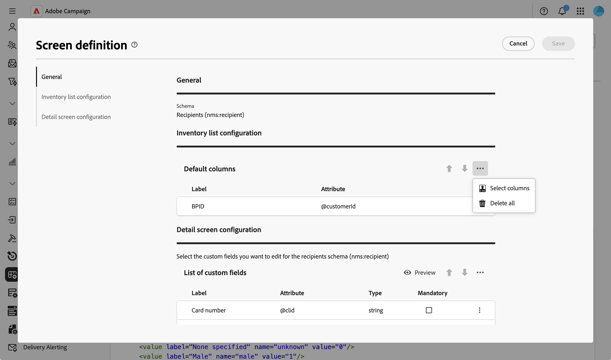
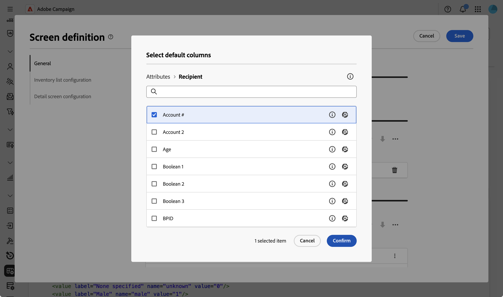
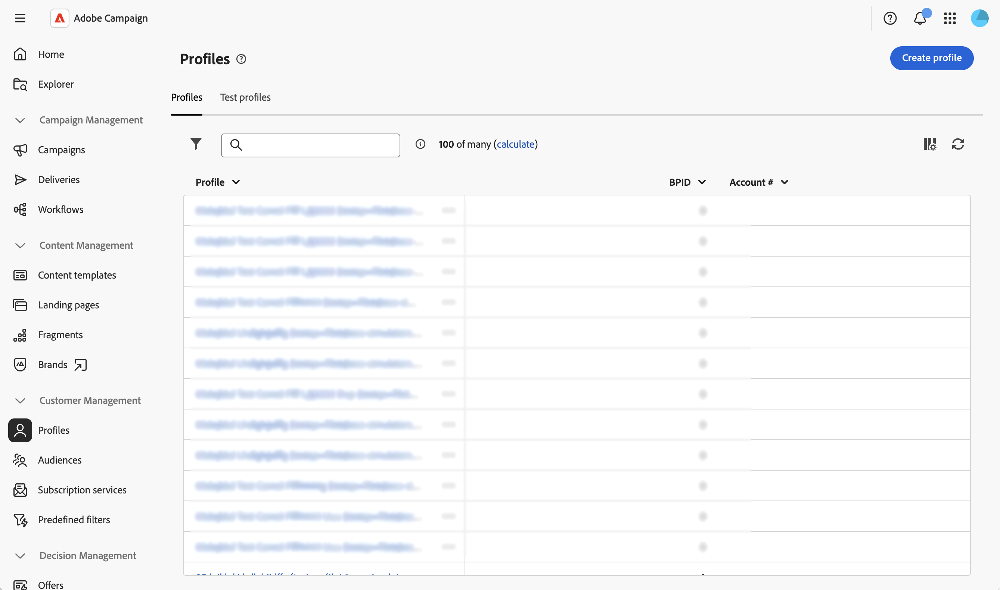

# Configurare le colonne di un elenco {#list-columns}

>[!CONTEXTUALHELP]
>id="acw_schema_inventory_list_configuration"
>title="Configurazione dell’elenco dell’inventario"
>abstract="Configura le colonne da visualizzare per impostazione predefinita nelle viste elenco. Ogni colonna presenta la propria etichetta e l’attributo corrispondente. Aggiungi filtri personalizzati per visualizzare i campi del filtro di accesso rapido nel riquadro dei filtri della vista a elenco."
>additional-url="https://experienceleague.adobe.com/docs/campaign-web/v8/conf/schemas/schemas-custom-filters.html?lang=it" text="Aggiungere filtri personalizzati"

La sezione **[!UICONTROL Configurazione dell&#39;elenco di inventario]** consente di configurare le colonne da visualizzare per impostazione predefinita nelle visualizzazioni elenco. Ogni colonna presenta la propria etichetta e l’attributo corrispondente.

Per ulteriori informazioni sulla schermata di definizione dello schermo e su come accedervi, fare riferimento alla sezione [Accedere alla definizione dello schermo](schemas-browse-access.md#screen-def).

Per aggiungere nuove colonne all&#39;elenco predefinito:

1. Accedi al menu **[!UICONTROL Schemi]** e individua gli schemi modificabili utilizzando i filtri.

1. Selezionare il nome dello schema nell&#39;elenco per aprirlo e fare clic sul pulsante **[!UICONTROL Screen edition]** nella visualizzazione dei dettagli dello schema per accedere alla definizione dello schermo.

1. Fai clic sull’icona con i puntini di sospensione (tre punti).
1. Scegliere **[!UICONTROL Seleziona colonne]**.
   

1. Seleziona gli attributi da visualizzare nelle viste a elenco e conferma.

   

1. Passare al menu **Profili** per accedere alla visualizzazione elenco dei profili. Le nuove schede vengono visualizzate. Se necessario, puoi aggiungere altre colonne.

   

>[!NOTE]
>
>È inoltre possibile aggiungere campi filtro di accesso rapido nel riquadro Filtri della visualizzazione elenco. Per ulteriori informazioni, vedere [Aggiungere filtri personalizzati](schemas-custom-filters.md).
