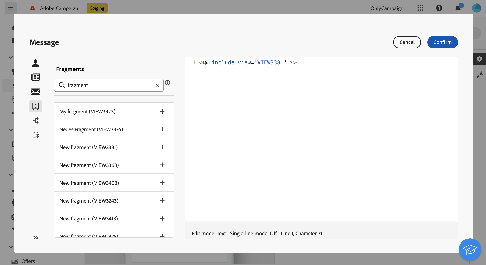

# Aggiungere frammenti di espressione nell’editor di espressioni {#expression}

>[!CONTEXTUALHELP]
>id="acw_fragments_list"
>title="Frammenti"
>abstract="In questo elenco vengono visualizzati tutti i frammenti di espressione creati nella sandbox attuale. Per utilizzare un frammento, fai clic sul pulsante + per aggiungere l’ID frammento nell’editor."

<!-- pas vu dans l'UI-->

I frammenti di espressione possono essere utilizzati in qualsiasi campo che può essere modificato utilizzando l’editor di espressioni. Per aggiungere frammenti di espressione al contenuto, segui i passaggi seguenti.

1. Apri [Editor espressioni](../personalization/gs-personalization.md) e seleziona il menu **[!UICONTROL Frammenti]** nel riquadro a sinistra.

   L’elenco mostra tutti i frammenti di espressione creati nella sandbox corrente.

1. Fai clic sull&#39;icona `+` accanto a un frammento di espressione per aggiungerlo al contenuto.

   

1. L’ID del frammento viene aggiunto all’editor. Se apri il frammento di espressione corrispondente e lo modifichi dall’interfaccia, le modifiche vengono sincronizzate automaticamente. Si propagano a tutte le consegne **[!UICONTROL Bozza]** contenenti tale ID frammento.