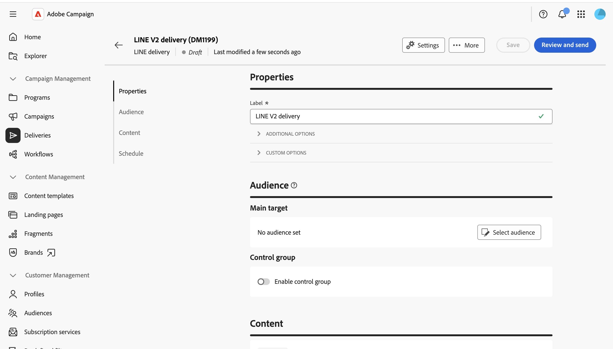
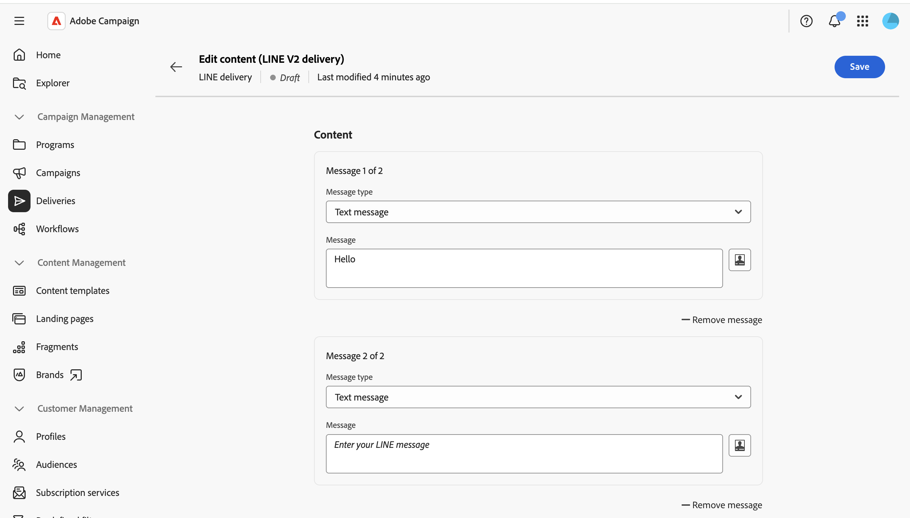
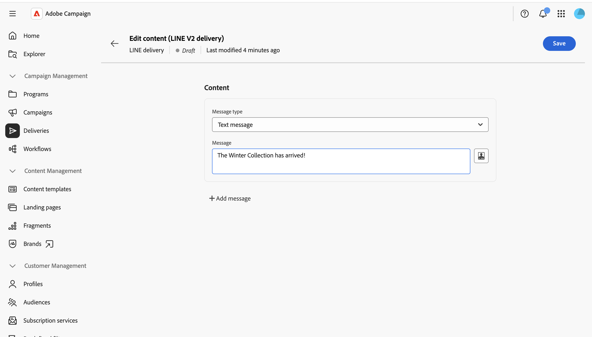
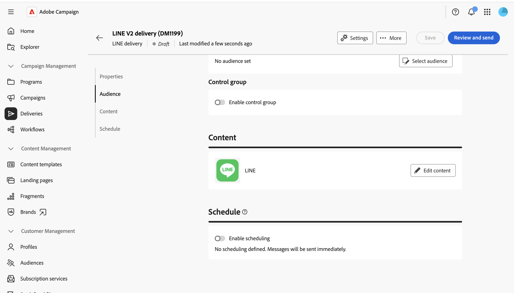
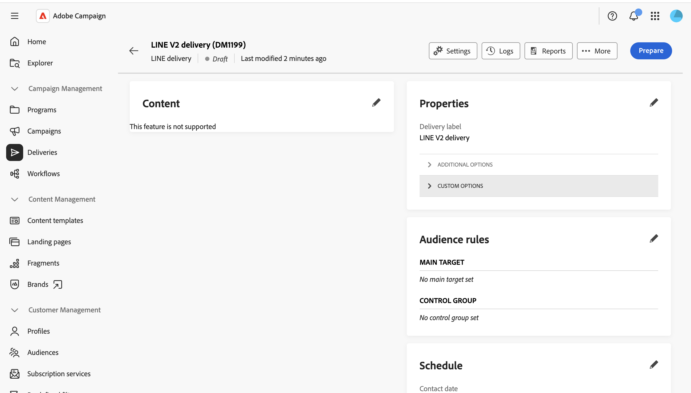

# Inviare un messaggio LINE {#send-line}

Puoi creare e inviare messaggi LINE ai tuoi abbonati utilizzando contenuti di testo, immagini o video. Le consegne LINE possono essere create come consegne autonome o aggiunte a un flusso di lavoro.

Questa pagina illustra come creare una consegna LINE indipendente, ma gli stessi passaggi si applicano quando si configura un’attività del canale LINE in un flusso di lavoro.

>[!IMPORTANT]
>
>L’anteprima dei messaggi non è attualmente supportata per le consegne LINE. Rivedi attentamente il contenuto nell’editor prima di inviare, poiché non puoi visualizzare in anteprima il messaggio renderizzato in precedenza.

## Creare una consegna LINE {#create-line-delivery}

1. Passa al menu **[!UICONTROL Consegne]** e fai clic su **[!UICONTROL Crea consegna]**.

1. Scegliere **[!UICONTROL LINE]** e selezionare un modello di consegna, ad esempio il modello predefinito **[!UICONTROL LINE V2 delivery]**. [Ulteriori informazioni sui modelli](../msg/delivery-template.md).

   

1. Fai clic su **[!UICONTROL Crea consegna]** per confermare e visualizzare la schermata di configurazione della consegna.

1. Inserisci un **[!UICONTROL Etichetta]** per la consegna e, se necessario, definisci opzioni aggiuntive o personalizzate. [Ulteriori informazioni](../push/create-push.md#configure-push-settings).

   

## Selezionare il pubblico {#audience}

1. Fai clic su **[!UICONTROL Seleziona pubblico]** per eseguire il targeting di un pubblico esistente o crearne uno. Il targeting per le consegne LINE si basa su **[!UICONTROL Abbonamenti visitatore]**. [Ulteriori informazioni sui tipi di pubblico](../audience/about-recipients.md)

1. Attiva l&#39;opzione **[!UICONTROL Abilita gruppo di controllo]** per impostare un gruppo di controllo e misurare l&#39;impatto della consegna. I messaggi non vengono inviati a tale gruppo di controllo, pertanto puoi confrontare il comportamento della popolazione che ha ricevuto il messaggio con quello dei contatti che non lo hanno fatto. [Ulteriori informazioni](../audience/control-group.md)

## Definire il contenuto {#content}

Fare clic su **[!UICONTROL Modifica contenuto]**.

Viene visualizzato l’editor di contenuti LINE.

Una consegna LINE può contenere fino a cinque messaggi. Fai clic su **[!UICONTROL Aggiungi messaggio]** per aggiungere un altro messaggio alla consegna oppure su **[!UICONTROL Rimuovi messaggio]** per eliminarne uno.

Puoi utilizzare, se disponibile, l’editor di personalizzazione per inserire contenuto dinamico. [Ulteriori informazioni](../personalization/personalize.md).

Ogni messaggio utilizza uno dei seguenti tipi.

>[!NOTE]
>
>Sono supportati solo gli URL immagine e video. Il caricamento di un file locale non è disponibile e corrisponde al comportamento della console client.

### Messaggio di testo {#text-message}

Un messaggio di testo è un semplice messaggio inviato sotto forma di testo. Digita il messaggio nel campo correlato e utilizza i campi di personalizzazione, se necessario.

### Messaggio con immagine {#image-message}

Un messaggio immagine ti consente di inviare un’immagine, facoltativamente divisa in aree selezionabili, ciascuna collegata a un URL diverso.

* **[!UICONTROL Immagine personalizzata]**: definisci l&#39;immagine in modo dinamico per destinatario.
* **[!UICONTROL URL immagine]**: fornisci l&#39;URL dell&#39;immagine. Le dimensioni consigliate sono 1040 x 1040 px. Abilita **[!UICONTROL Definisci le immagini per le dimensioni dello schermo del dispositivo]** per fornire diverse risoluzioni di immagine ottimizzate per diverse dimensioni dello schermo.
* **[!UICONTROL Testo alternativo]**: testo alternativo obbligatorio, visualizzato se l&#39;immagine non può essere caricata.
* **[!UICONTROL Collegamenti]**: scegli un layout per dividere l&#39;immagine in una o più aree selezionabili, quindi assegna un URL a ogni area.

### Messaggio video {#video-message}

Un video messaggio ti consente di inviare un video ai destinatari.

* **[!UICONTROL URL video]**: URL del video. È supportato solo il formato MP4.
* **[!UICONTROL URL immagine anteprima]**: URL di un&#39;immagine visualizzato prima della riproduzione del video.

## Pianificare e inviare {#schedule-send}

1. Dopo aver definito il contenuto, fai clic su **Salva**, quindi fai clic sull&#39;icona Indietro per tornare alla schermata di configurazione della consegna.

1. Abilita **[!UICONTROL Abilita pianificazione]** per l&#39;invio in una data e un&#39;ora specifiche. [Ulteriori informazioni](../msg/create-deliveries.md#gs-schedule).

   

1. Quando il contenuto è pronto, fai clic su **[!UICONTROL Rivedi e invia]**. Viene aperto il dashboard di consegna.

   

1. Fai clic su **[!UICONTROL Prepara]**, quindi conferma. In caso di errori, correggerli e fare di nuovo clic su **[!UICONTROL Prepara]**.

1. Fai clic su **[!UICONTROL Invia]**. Puoi quindi tenere traccia dei risultati dai punti di ingresso **[!UICONTROL Rapporti]** e **[!UICONTROL Registri]** della consegna.
