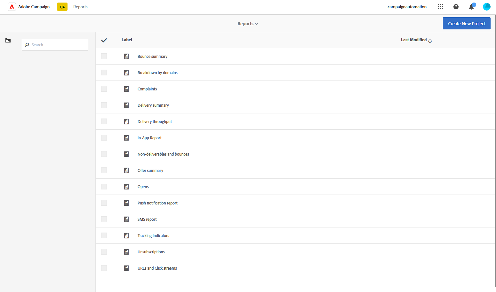

# Introduzione ai rapporti dinamici {#about-dynamic-reports}

Reporting dinamico fornisce rapporti completamente personalizzabili e in tempo reale. Consente di accedere ai dati del profilo, abilitando l’analisi demografica per dimensioni di profilo, come genere, città ed età, oltre ai dati funzionali delle campagne e-mail come aperture e clic. L’interfaccia di trascinamento consente di esaminare i dati, determinare le prestazioni delle campagne e-mail rispetto ai segmenti di clienti più importanti e misurare il loro impatto sui destinatari.

## Accesso ai report dinamici {#accessing-dynamic-reports}

Per accedere ai report in ogni campagna e consegna, fai clic su **Report**. Verrà visualizzata una finestra popup che informa che verrà eseguito il reindirizzamento alla pagina **Report dinamico** in una nuova scheda del browser.

Alcuni rapporti non possono essere disponibili immediatamente dopo una consegna, a seconda del tempo necessario per raccogliere ed elaborare le informazioni.

I rapporti dinamici sono suddivisi in due categorie:

* **Modelli**, che possono essere modificati copiandoli con l&#39;opzione **Salva con nome** (**Progetto > Salva con nome..**) nel modello.
* **Report personalizzati** (identificati in blu), che possono essere creati direttamente facendo clic sul pulsante **Crea nuovo progetto** nella home page di **Report**.

